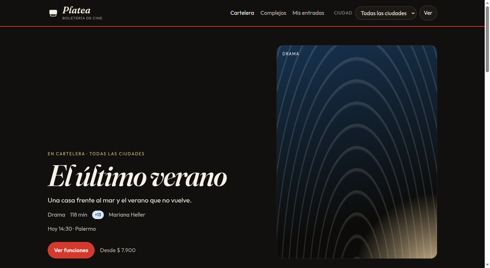
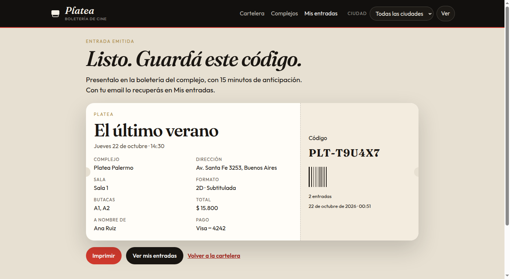

# Platea

Boletería de cine de demostración, hecha en Java con Spring Boot. Tiene cartelera, complejos en cuatro ciudades, funciones de los próximos días, mapa de butacas, reserva con cuenta regresiva y emisión de entradas con código propio.

El pago es simulado. No se cobra nada y la tarjeta no se guarda: en la entrada quedan la marca y los últimos cuatro números.



## Para qué sirve en un portfolio

Es una aplicación web completa, de punta a punta, con las piezas que se esperan en un proyecto Java de muestra:

- páginas server-side con Thymeleaf, pensadas para escritorio y celular
- modelo persistido con JPA e H2, sin servicios externos
- reserva de butacas en una transacción, con bloqueo pesimista de la función para que dos compras no se queden con el mismo asiento
- validación del formulario y un pago simulado que rechaza tarjetas inválidas o terminadas en `0000`
- tests del flujo de compra y de las reglas de precio, slug y tarjeta

Los datos de películas, complejos y funciones se cargan al arrancar. Cada reinicio vuelve a armar la cartelera.

## Qué se puede hacer

- Filtrar la cartelera por ciudad (Buenos Aires, Córdoba, Rosario, Mendoza) y por género.
- Ver la ficha de una película, los estrenos de **Próximamente** y la ficha de cada complejo.
- Elegir una función en 2D, 3D, IMAX o 4DX y marcar hasta 8 butacas. Las preferenciales tienen un recargo.
- Retener las butacas 8 minutos y pagar dentro de esa ventana.
- Recibir una entrada `PLT-……` con código de barras.
- Recuperarla en **Mis entradas** con el email de la compra o con el código.

Los complejos de la demo son Platea Palermo, Puerto y Belgrano (Buenos Aires), Nueva Córdoba, Rosario y Mendoza.



## Stack

| Pieza | Uso |
| --- | --- |
| Java 21 | Lenguaje |
| Spring Boot 4 | Aplicación web |
| Spring MVC + Thymeleaf | Pantallas |
| Spring Data JPA + Hibernate | Películas, funciones, butacas y compras |
| Bean Validation | Formulario de pago |
| H2 en memoria | Base de la demo |
| JUnit 5 + MockMvc | Tests |
| Maven Wrapper | Compilación sin instalar Maven |

## Requisitos

- Java 21

Maven no hace falta tenerlo instalado: el proyecto trae `./mvnw`.

## Correr en local

```bash
./mvnw spring-boot:run
```

Abrí [http://localhost:8741](http://localhost:8741).

El puerto se puede cambiar con la variable `PORT`:

```bash
PORT=8080 ./mvnw spring-boot:run
```

## Comprar una entrada de prueba

1. Elegí una película y una función que no esté agotada.
2. Marcá las butacas y continuá. Quedan retenidas 8 minutos.
3. En el pago usá `4242 4242 4242 4242`, un vencimiento futuro y cualquier CVV de 3 o 4 dígitos.
4. Un número que termina en `0000` (por ejemplo `4000 0000 0002 0000`) simula un rechazo del banco. Las butacas siguen reservadas para reintentar.
5. La entrada queda en **Mis entradas**, buscable por email o por el código `PLT-……`.

El precio de base depende del formato y sube viernes, sábado y domingo. Una preferencial suma $ 1.800.

## Tests

```bash
./mvnw test
```

`PlateaLogicTest` cubre el formato de precios, los slugs, el algoritmo de Luhn y el recargo de fin de semana. `BookingFlowTest` recorre la cartelera, retiene butacas, emite la entrada, rechaza la tarjeta terminada en ceros y no deja vender dos veces el mismo asiento.

En GitHub, el workflow `.github/workflows/tests.yml` corre esa suite en cada push.

## Cómo está armada

```
src/main/java/ar/com/platea
├── domain        Película, complejo, sala, función, reserva y compra
├── repo          Spring Data JPA
├── service       Cartelera, precios, layout de sala, reserva y pago
├── view          Datos que consumen las pantallas
└── web           Controladores MVC
src/main/resources
├── templates     Thymeleaf
└── static        CSS y el mapa de butacas
```

El recorrido de una compra:

1. `ShowtimeController` recibe las butacas elegidas.
2. `BookingService` bloquea la función (`PESSIMISTIC_WRITE`), suelta reservas vencidas y crea un hold de 8 minutos atado a la sesión HTTP.
3. El checkout valida nombre, email y tarjeta. `CardValidator` aplica Luhn, vencimiento y la regla del `0000`.
4. Si el pago entra, las butacas pasan a vendidas y se emite un `Booking` con código `PLT-` de 6 caracteres.
5. `TicketController` muestra la entrada y la búsqueda de **Mis entradas**.

`CatalogSeeder` arma 11 películas (dos todavía sin estrenar), 6 complejos y las funciones de los próximos días, con parte de la sala ya ocupada para que el mapa no arranque vacío.

## Publicar el código en GitHub

Creá un repositorio público vacío, sin README, para que no choque con este historial. Después, desde esta carpeta:

```bash
git remote add github https://github.com/TU-USUARIO/platea.git
git push -u github main
```

Conviene que el repositorio se llame `platea` y que la descripción sea corta, por ejemplo: «Boletería de cine de demostración en Java y Spring Boot».

## Hostear una demo gratis

GitHub Pages publica sitios estáticos. Esta aplicación es un proceso Java y necesita un servidor. La forma gratuita de mostrar una demo en un portfolio es un contenedor que escala a cero o se duerme cuando nadie entra.

El `Dockerfile` de la raíz deja la app escuchando en la variable `PORT`, que es lo que usan estos servicios. La imagen corre con un usuario sin privilegios.

### Render

El plan gratuito de Render alcanza para una demo. El servicio se duerme tras un rato sin visitas y la primera carga después de eso tarda, porque vuelve a arrancar Java y a sembrar la cartelera.

1. Subí el código a GitHub.
2. En [render.com](https://render.com) creá un **Blueprint** y elegí este repositorio. `render.yaml` ya declara el servicio web. Si el blueprint rechaza el plan free, creá un Web Service a mano con runtime Docker y la instancia gratuita.
3. Cuando termine el build, Render muestra una URL pública `https://platea-….onrender.com`.

Si el plan free de la cuenta ya no ofrece instancias, o el arranque se queda sin memoria, el camino siguiente es Cloud Run con 1 GiB.

### Google Cloud Run

Cloud Run tiene una cuota mensual gratuita y la instancia baja a cero cuando no hay tráfico. Hace falta un proyecto de Google Cloud con facturación activada. Con visitas ocasionales de un portfolio el uso se mantiene dentro de esa cuota, siempre que el mínimo de instancias quede en cero.

```bash
gcloud run deploy platea \
  --source . \
  --region southamerica-east1 \
  --allow-unauthenticated \
  --memory 1Gi \
  --min-instances 0
```

`southamerica-east1` es São Paulo, la región más cercana para una demo pensada desde Argentina.

### Qué esperar de la demo hosteada

- La base es H2 en memoria. Cada vez que el proceso se duerme o se reinicia, las compras de prueba desaparecen y la cartelera se vuelve a cargar.
- Hay una sola instancia. Las reservas viven en la sesión de quien está comprando.
- El arranque en frío puede tardar cerca de un minuto en el plan que se duerme.
- No reemplaza un cine real: no hay cobro, mails ni usuarios registrados.

## Límites a propósito

Quedó afuera todo lo que una boletería de producción necesitaría y una muestra no tiene que simular: cuentas de espectadores, mail de la entrada, pasarela de pago, base durable y más de una instancia. El objetivo es que se pueda clonar, correr y recorrer una compra completa con Java y Spring Boot.
