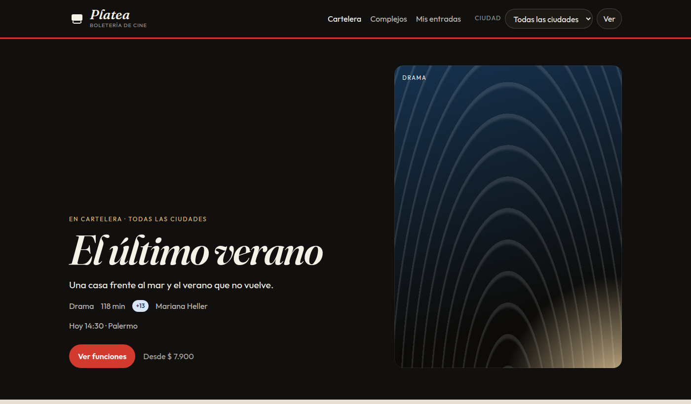
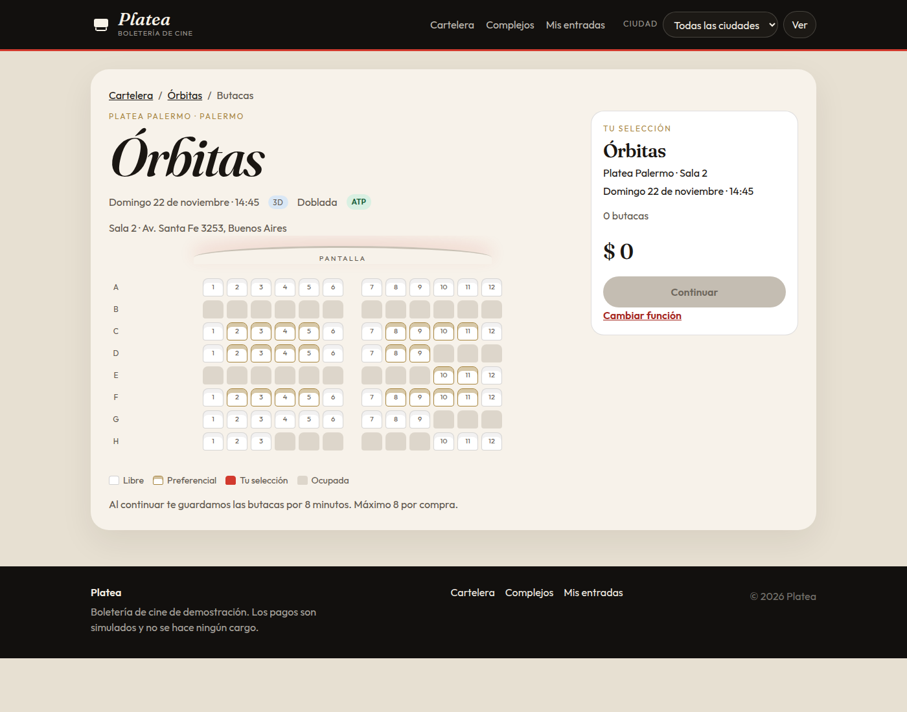
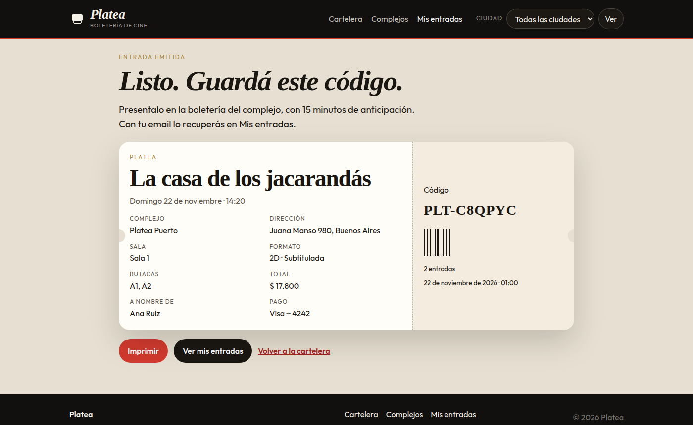
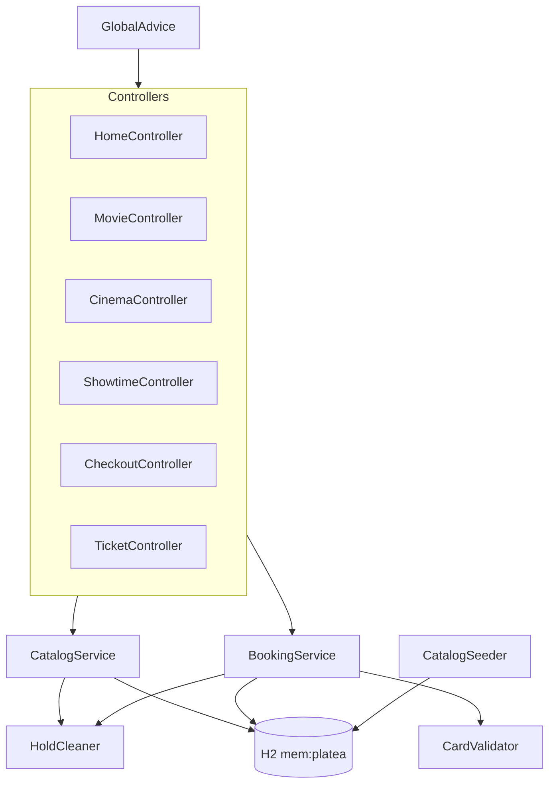
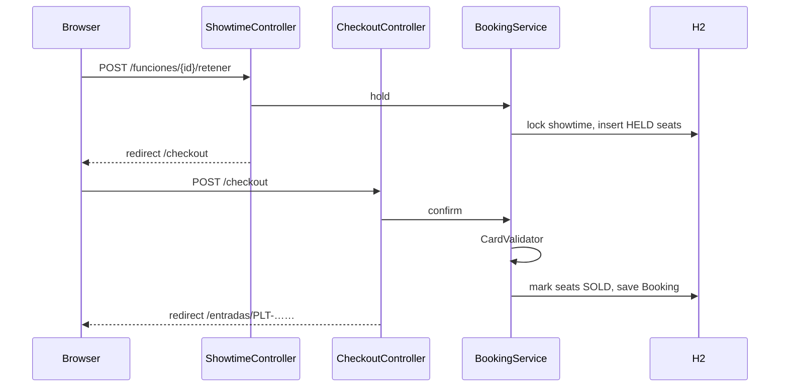
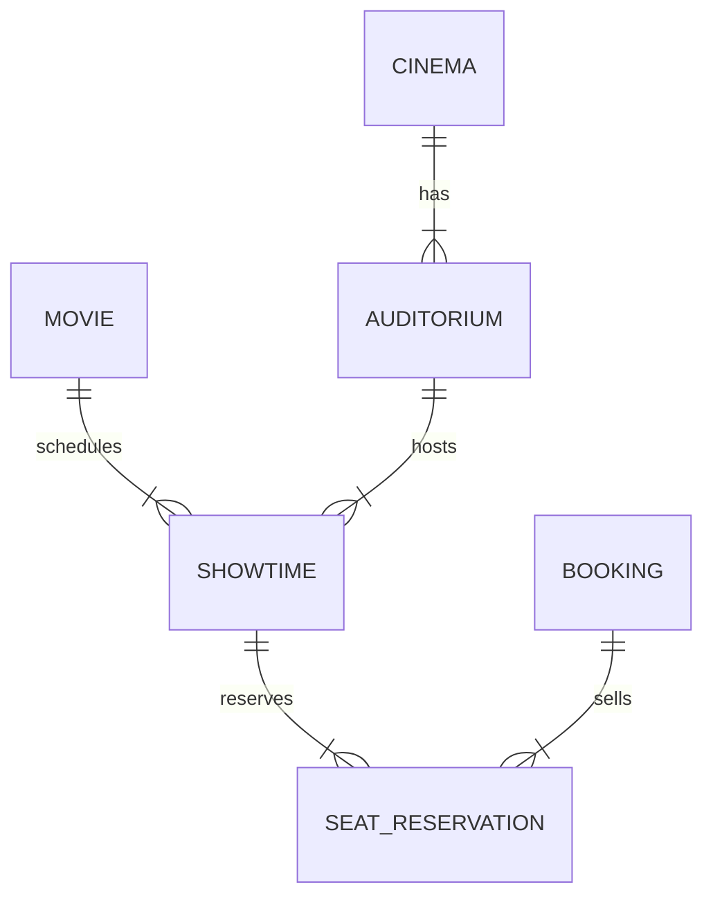

# Platea

A demo cinema box office in Java and Spring Boot. The Spanish-language site lists six cinemas in four cities, holds seats for eight minutes, and issues a `PLT-` ticket after a simulated card payment.

The charge is simulated. The only card data Platea stores is the brand and the last four digits.

[](https://docs.oracle.com/en/java/javase/21/)
[](https://spring.io/projects/spring-boot)
[](https://www.thymeleaf.org/)
[](https://www.h2database.com/)
[](https://maven.apache.org/)
[](https://github.com/iavicoliNicolas/boleteria-cine/actions/workflows/tests.yml)



The “Desde” amount on a card is the lowest base price in the six-day window, so on a weekend it can still show the Monday–Thursday price.

## Features

- Billboard for Buenos Aires, Córdoba, Rosario, and Mendoza, with search and a genre filter. The city choice is kept in the HTTP session.
- Movie pages for the next six days, plus a **Próximamente** section for titles that are not on sale yet.
- A page per cinema, with that complex’s showtimes for today and tomorrow.
- Showtimes in 2D, 3D, IMAX, and 4DX, tagged subtitled, dubbed, or original language.
- A seat map for up to eight seats. Premium seats in the middle of the room add $ 1.800.
- An eight-minute hold tied to the browser session, with a countdown on the checkout page.
- Simulated checkout. A card that fails the Luhn check, is expired, or ends in `0000` is declined, and the seats stay held so the buyer can retry.
- A ticket coded `PLT-` followed by six characters, a barcode-style graphic drawn from that code, and a print view.
- **Mis entradas** finds a purchase by email or by ticket code.

Posters are CSS motifs painted from colors stored on each movie. Restarting the process rebuilds the billboard in an in-memory H2 database.





## Demo catalog

Eleven original titles. Nine are on sale, and two are coming soon (`Viento norte`, 21 days after startup, and `El faro de Quequén`, 35 days after startup). The featured film is *El último verano*. Seeded ratings are ATP, +13, and +16.

| Cinema | City | Neighborhood | Address | Auditoriums |
| --- | --- | --- | --- | --- |
| Platea Palermo | Buenos Aires | Palermo | Av. Santa Fe 3253 | Sala 1, Sala 2, Sala IMAX |
| Platea Puerto | Buenos Aires | Puerto Madero | Juana Manso 980 | Sala 1, Sala 4DX, Sala 3 |
| Platea Belgrano | Buenos Aires | Belgrano | Av. Cabildo 2120 | Sala 1, Sala 2 |
| Platea Nueva Córdoba | Córdoba | Nueva Córdoba | Obispo Trejo 650 | Sala 1, Sala IMAX, Sala 3 |
| Platea Rosario | Rosario | Centro | Córdoba 1340 | Sala 1, Sala 2 |
| Platea Mendoza | Mendoza | Centro | Av. San Martín 845 | Sala 1, Sala 2 |

The seeder repeats one daily schedule for six days: 306 showtimes, across 15 auditoriums. It marks part of each room sold so the map is not empty, and it leaves at least 10 seats free. The target occupancy is higher when the show is sooner, and a bit higher for *Nebulosa* and *Código Austral*.

## Tech stack

Versions below are the ones this build resolves.

| Piece | Role |
| --- | --- |
| Java 21 | Language |
| Spring Boot 4.1.1 | Application and embedded Tomcat |
| Spring MVC + Thymeleaf 3.1.5 | Server-rendered pages, locale `es-AR` |
| Spring Data JPA + Hibernate 7.4.5.Final | Movies, showtimes, seats, and purchases |
| Bean Validation | Checkout form |
| H2 2.4.240 | In-memory database, created on startup and dropped on shutdown |
| JUnit Jupiter, AssertJ, and MockMvc | Tests |
| Maven 3.10.0 via the Wrapper | Build without a preinstalled Maven |

The UI is one stylesheet (`platea.css`) and two scripts (`butacas.js`, `checkout.js`). Headlines use Fraunces and the UI uses Outfit, loaded from Google Fonts, with system-font fallbacks in the stylesheet.

## Architecture

Pages go through MVC controllers. `CatalogService` builds the billboard, movie, cinema, and seat-map view models. `BookingService` holds seats and confirms a purchase. `CatalogSeeder` runs once on startup through `DataSeeder`.



A purchase:





## Project structure

```
src/main/java/ar/com/platea
├── config          Clock in America/Argentina/Buenos_Aires, fixed es-AR locale
├── domain          JPA entities and enums (movie, cinema, showtime, seat, booking)
├── repo            Spring Data repositories, including the pessimistic showtime lock
├── service         Seeding, catalog queries, pricing, seat layout, holds, and card checks
├── view            Record view models for the templates
└── web             MVC controllers and the checkout form
src/main/resources
├── templates       Thymeleaf pages and the shared header/footer
├── static          CSS, seat-map script, checkout script, favicon
├── application.properties
└── banner.txt
src/test/java/ar/com/platea
├── PlateaLogicTest
└── BookingFlowTest
```

## Run locally

Java 21 is the only requirement. `./mvnw` downloads Maven 3.10.0 on first use.

```bash
./mvnw spring-boot:run
```

Open [http://localhost:8741](http://localhost:8741).

The listen port is `PORT`, defaulting to 8741. The process binds `0.0.0.0`.

```bash
PORT=8080 ./mvnw spring-boot:run
```

Thymeleaf template caching follows `THYMELEAF_CACHE` (off by default, on in the container). The session lasts 30 minutes. The session cookie is `HttpOnly`. Error responses omit the exception message, binding errors, and the stack trace.

H2 uses the in-memory URL `jdbc:h2:mem:platea`, user `sa`, and an empty password. The H2 console is not enabled. `ddl-auto` is `create-drop`, so every start loads a fresh catalog and drops the previous purchases.

### Try a purchase

1. Open a movie and a showtime that is not sold out.
2. Select up to eight seats and continue. They are held for eight minutes.
3. Pay with `4242 4242 4242 4242`, a future expiry such as `12/30`, and any 3- or 4-digit CVV. The name needs at least three characters. The phone is optional.
4. A number that passes the Luhn check and ends in `0000`, such as `4000000000020000`, is declined with “El banco rechazó el pago”. The hold remains.
5. The ticket is at `/entradas/PLT-……` and under **Mis entradas**, by email or by code.

Prices are Argentine pesos, grouped with a dot (`$ 7.900`). The base price depends on format and on the day of the show. Friday, Saturday, and Sunday use the higher column. A premium seat adds $ 1.800 on top.

| Format | Monday–Thursday | Friday–Sunday |
| --- | ---: | ---: |
| 2D | $ 7.900 | $ 8.900 |
| 3D | $ 9.900 | $ 10.900 |
| IMAX | $ 13.900 | $ 15.200 |
| 4DX | $ 15.900 | $ 17.200 |
| Premium seat | + $ 1.800 | + $ 1.800 |

The “Desde” price on a movie card is the lowest base price among that film’s showtimes in the six-day window.

## HTTP routes

These routes return HTML pages.

| Method | Path | Purpose |
| --- | --- | --- |
| `GET` | `/` | Billboard. `q` searches title, director, genre, and cast, ignoring accents. `genero` is an enum name such as `ANIMACION`. `ciudad` sets or, when empty, clears the session city. |
| `GET` | `/peliculas/{slug}` | Movie and showtimes. `fecha` is an ISO date inside the six-day window. |
| `GET` | `/complejos` | Cinemas in the active city, or all six when no city is selected. |
| `GET` | `/complejos/{slug}` | One cinema and its showtimes for today and tomorrow. |
| `GET` | `/funciones/{id}` | Seat map. Seats already held by this session are marked as yours. |
| `POST` | `/funciones/{id}/retener` | Hold the repeated field `butacas` (seat codes such as `A1`). Redirects to `/checkout`, or back to the map with a flash error. |
| `GET` | `/checkout` | Payment form. With no live hold, the heading is “No tenés butacas reservadas”. |
| `POST` | `/checkout` | Validate the form, run the simulated payment, and redirect to the ticket. |
| `POST` | `/checkout/soltar` | Drop this session’s hold. `funcion` sends the browser back to that seat map. |
| `GET` | `/entradas/{code}` | Ticket. Unknown codes answer 404. |
| `GET` | `/mis-entradas` | Lookup. `q` containing `@` searches by email. Any other value is treated as a ticket code and redirects when it matches. |

```bash
curl -s -o /dev/null -w "%{http_code}\n" http://localhost:8741/
curl -s -o /dev/null -w "%{http_code}\n" http://localhost:8741/peliculas/el-ultimo-verano
curl -s -o /dev/null -w "%{http_code}\n" "http://localhost:8741/?ciudad=Mendoza"
```

Hold two seats, then pay. `ID` is the showtime id from a movie or seat-map URL. Seat codes that the seeder already marked sold will be rejected.

```bash
curl -c cookies.txt -b cookies.txt -D - -o /dev/null \
  -X POST --data-urlencode 'butacas=A1' --data-urlencode 'butacas=A2' \
  "http://localhost:8741/funciones/${ID}/retener"

curl -c cookies.txt -b cookies.txt -D - -o /dev/null \
  -X POST \
  --data-urlencode 'nombre=Ana Ruiz' \
  --data-urlencode 'email=ana.ruiz@platea.test' \
  --data-urlencode 'tarjeta=4242 4242 4242 4242' \
  --data-urlencode 'vencimiento=12/30' \
  --data-urlencode 'cvv=123' \
  --data-urlencode 'titular=ANA RUIZ' \
  http://localhost:8741/checkout
```

A successful payment responds `302` with `Location: /entradas/PLT-……`. The ticket HTML includes the brand and the last four digits, and it does not include the full card number.

## Tests

```bash
./mvnw test
```

`PlateaLogicTest` checks peso formatting, accent-free slugs, weekday and weekend prices, which seats are premium, the Luhn acceptance of `4242…4242`, and rejection of an expired card and of a card ending in `0000`.

`BookingFlowTest` loads the full application and, through MockMvc, checks the billboard, city and genre filters, a coming-soon title, a missing movie (404), a hold, a ticket, email and code lookup, a declined card that keeps the hold, and a second session that cannot take a seat the first session already holds.

[`.github/workflows/tests.yml`](.github/workflows/tests.yml) runs `./mvnw -B test` on Ubuntu with Temurin 21 for every push and pull request.

## Container

The root `Dockerfile` is a two-stage build: Temurin 21 JDK packages the jar with `./mvnw -B -DskipTests package`, and Temurin 21 JRE runs it. The process user is `platea` (uid 10001). The image sets `PORT=8741`, `THYMELEAF_CACHE=true`, and `JAVA_TOOL_OPTIONS=-XX:MaxRAMPercentage=75`.

```bash
docker build -t platea .
docker run --rm -p 8741:8741 platea
```

[`render.yaml`](render.yaml) declares a free Docker web service named `platea`, with health check `/` and `THYMELEAF_CACHE=true`. Any host that runs this image can set `PORT`; the app reads it in `application.properties`.

Because the database is in memory and the catalog is seeded on startup, a process that stops or sleeps drops the demo purchases and builds the billboard again. Holds are stored on the HTTP session, so they belong to a single process.

## Technical notes

- `ShowtimeRepository.lockById` takes a `PESSIMISTIC_WRITE` lock on the showtime row before inserting a hold. `seat_reservations` also has a unique constraint on `(showtime_id, seat_code)`, so two buyers cannot persist the same seat.
- Holds last eight minutes (`BookingService.HOLD_MINUTES`). `HoldCleaner` deletes expired `HELD` rows in a new transaction when a catalog or booking operation runs.
- Starting a new hold deletes that session’s previous `HELD` seats first, so a second selection replaces the first.
- A seat is premium when the room has at least five rows, the row is outside the first two and the last two, and the seat is neither the first nor the last of its half of the row. The browser disables further checkboxes at eight seats; the server rejects a larger selection as well.
- Ticket codes use `PLT-` plus six characters from an alphabet that omits `I`, `O`, `0`, and `1`, and they are checked for uniqueness before insert. The graphic on the stub is drawn from those characters for display.
- `CardValidator` requires 13 to 19 digits and a valid Luhn checksum. A number that ends in `0000` is declined next. The expiry must be `MM/YY` or `MM/YYYY` and not before the current month, and the CVV must be 3 or 4 digits. Brands are American Express (`34`/`37`), Visa (`4`), Mastercard (`5` or `2`), and `Tarjeta` otherwise.
- The persisted payment fields are `cardBrand` and `cardLast4`. The log line for an issued ticket records the code and the email.
- `spring.jpa.open-in-view` is `false`. Showtime queries fetch the movie, auditorium, and cinema in one select. Booking lookups use an entity graph so the ticket page does not lazy-load outside the transaction.
- Dates and the application clock use `America/Argentina/Buenos_Aires`. Money and copy on the pages are Spanish (`es-AR`).
- Slugs are lowercase, ASCII, and hyphenated (`Órbitas` becomes `orbitas`). The same folding is used by search.

## What this demo leaves out

Accounts, email delivery, a real payment processor, a durable database, and more than one application instance. The goal is a complete purchase that can be cloned and run with Java and Spring Boot.

## Credits

Nicolás Iavicoli Dulcet ([@iavicoliNicolas](https://github.com/iavicoliNicolas)).

In git history, `Initialize project` is authored by nicolas iavicoli. The commits that add the application and the earlier README list Cursor Agent as author and nicolaseliavicoli as co-author.

## Resumen en español

Platea es una boletería de cine de demostración hecha en Java 21 y Spring Boot 4.1.1. La interfaz está en español. Hay cartelera en Buenos Aires, Córdoba, Rosario y Mendoza, seis complejos, funciones en 2D, 3D, IMAX y 4DX, un mapa de butacas, una reserva de ocho minutos y un pago simulado que emite una entrada `PLT-`. No se cobra nada: de la tarjeta se guardan la marca y los últimos cuatro números.

```bash
./mvnw spring-boot:run
```

Abrí [http://localhost:8741](http://localhost:8741). Para probar el pago usá `4242 4242 4242 4242`, un vencimiento futuro (por ejemplo `12/30`) y un CVV de 3 o 4 dígitos. Una tarjeta que termina en `0000` simula un rechazo del banco y deja las butacas retenidas. Los datos viven en H2 en memoria y se vuelven a cargar en cada arranque. `./mvnw test` corre la suite.
